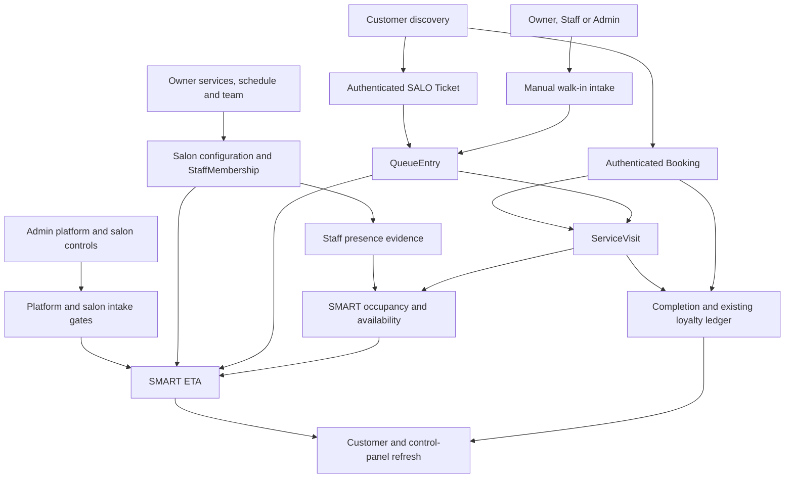

# SALO system integration and development map

Consolidated 2026-11-16 from the current verified working tree. Origin is
`bdkd103-maker/salon`; fetched `salo-cloud-development` is
`6d541047ca095c2c6f1acf0d399513c587df9b10`. Task branch `salo-cloud-work` at
`b0fec5de6142d2d42d8d013879fc67fc723cf762` descends from it and also has
uncommitted booking-policy/UI work. These are different provenance layers;
this document does not claim local review work is merged or published.

This is a code map, not permission to change business rules or proof of runtime
correctness. Owner decisions are in [requirements](SALO-PRODUCT-REQUIREMENTS.md),
implementation/evidence in [knowledge](SALO-PROJECT-KNOWLEDGE.md) and
[feature status](SALO-FEATURE-STATUS.md), and all next work belongs in the
[single engineering backlog](SALO-ENGINEERING-BACKLOG.md).

## Runtime and role ownership

The static root pages/assets have matching `www/` Capacitor copies. They call
the Fastify API registered in [server.ts](../backend/src/server.ts). That module
listens and loads configuration at startup; do not import it for offline checks.
Routes use Prisma/PostgreSQL. SQL constraints and partial indexes supplement
the [Prisma schema](../backend/prisma/schema.prisma); generated Client types
alone cannot verify the database catalog.

| Actor | Frontend and normal responsibilities | Server boundary |
| --- | --- | --- |
| Customer | Main/Women discovery, profile, favorites, own booking/ticket and loyalty | Persisted authenticated user and resource ownership; booking creation is CUSTOMER-only |
| Owner | Owner modal, salon settings/services, team, queue, subscriptions and messages | Salon ownership; explicit Admin exceptions where implemented |
| Staff | Staff modal, duty/presence, own visit operations and salon booking reads | ACTIVE/unrevoked membership, matching salon/barber and own membership for visit actions |
| Admin | Standalone `admin/` workspace plus legacy inline administration | Persisted ADMIN checks and route-specific lifecycle/platform controls |

See [auth](../backend/src/lib/auth.ts) and
[staff membership](../backend/src/lib/staff-membership.ts). Do not transfer
permissions between endpoints merely because a panel displays their data.
Staff booking reads are membership-based; broader booking mutation permissions
remain an owner decision. Local storage and JWT role claims alone are not the
authorization boundary.

## Operational flow

Arrows describe code dependencies, not automatic transitions or a new product
workflow. Booking creation does not create a queue ticket. Queue start does not
complete service. Visit completion does not imply every related record is
automatically transitioned; inspect the individual handler before changing it.

The current booking-backed visit start accepts PENDING or CONFIRMED bookings,
locks the booking and validates its assignment; it does not change the booking
status there. This is a code observation, not a new confirmation policy.
Completion earning uses a booking-based transaction key for linked work; a
linked visit must be COMPLETED before booking completion can earn through it.
The ledger requires an active Customer identity, so anonymous manual intake
does not acquire a fabricated loyalty identity. These guards do not substitute
for separately authorized database concurrency/idempotency verification.

## Exact API and source contracts

All URLs below include `/api/v1`. Source links are the implementation owners;
they are not instructions to contact a database or execute every route test.

| Workflow | Registered endpoints | Implementation and affected records |
| --- | --- | --- |
| Customer session | `/auth/login`, `/auth/refresh`, `/auth/me`, verification/reset routes | [auth routes](../backend/src/routes/auth.ts), persisted User/Session/challenges |
| Discovery/configuration | `/salons`, `/salons/:id`; salon services/hours/media routes | [salons](../backend/src/routes/salons.ts), Salon/Service/Barber; public projections differ from Owner/Admin data |
| Customer booking | POST `/bookings`, GET `/bookings/me` | [bookings](../backend/src/routes/bookings.ts), authenticated Customer, salon/service/barber context, schedule and overlap validation, PENDING creation |
| Booking operations | GET `/bookings`, PATCH/DELETE `/bookings/:id` | Same route file; customer ownership, Owner salon scope, Staff read membership and explicit Admin paths differ |
| Team/read context | `/salons/:salonId/team`, `/staff/me`, GET `/salons/:salonId/queue` | [owner-team](../backend/src/routes/owner-team.ts), User/Barber/StaffMembership, lease and active-visit context |
| SALO Ticket | POST `/salons/:salonId/queue/tickets`, GET `/queue/tickets/mine`, POST `/salons/:salonId/queue/:queueEntryId/cancel` | [queue](../backend/src/routes/queue.ts); Customer-owned SALO_TICKET, active-ticket reuse/guards and cancellation ownership |
| Manual walk-in | POST `/salons/:salonId/queue/walk-in` | Same queue file; Owner/Staff/Admin access checks, intake gates, anonymous MANUAL_WALK_IN entry |
| Queue to service | POST `/salons/:salonId/queue/:queueEntryId/start` | Same queue file; checked membership and queue context, transactional ServiceVisit linkage and version guards |
| Duty/presence | PATCH `/salons/:salonId/staff/:staffMembershipId/duty`, POST `/salons/:salonId/staff/:staffMembershipId/presence/confirm`, GET `/salons/:salonId/staff/status` | [staff-status](../backend/src/routes/staff-status.ts), [presence helper](../backend/src/lib/staff-presence.ts), generation/lease evidence and derived occupancy |
| Direct service visit | POST `/salons/:salonId/service-visits`, PATCH `/salons/:salonId/service-visits/:visitId/complete` | Same staff-status file, [visit helper](../backend/src/lib/service-visit.ts), membership/presence, booking lock/assignment/status checks, completion ledger |
| SMART public status | GET `/salons/:salonId/live-status`, GET `/salons/live-status?salonIds=...` | Same staff-status file, [real-data adapter](../backend/src/lib/smart-wait-data.ts), [pure ETA engine](../backend/src/lib/smart-wait.ts) |
| Completion/rewards | Booking completion and ServiceVisit completion call earning helpers; `/loyalty/*` exposes reward flows | [ledger](../backend/src/lib/loyalty-ledger.ts), [loyalty routes](../backend/src/routes/loyalty.ts), unique transaction evidence and guarded balance changes |
| Communication | `/messages`, `/notifications`, `/notifications/read`, `/device-tokens` | [dashboard routes](../backend/src/routes/dashboard.ts), [notification helper](../backend/src/lib/notifications.ts), [device tokens](../backend/src/routes/device-tokens.ts); provider delivery is a separate boundary |
| Global administration | `/admin/*`, platform settings, legal, catalog and salon lifecycle routes | [server registration](../backend/src/server.ts), [platform settings](../backend/src/routes/platform-settings.ts), salon lifecycle helpers; destructive policy is not inferred from UI controls |

## Distinct lifecycles and data relationships

| Record/output | Code values | Integration consequence |
| --- | --- | --- |
| Booking | PENDING, CONFIRMED, CANCELLED, COMPLETED, NO_SHOW | Scheduled customer resource; existing transition and authorization rules stay in the booking handler |
| QueueEntry source | SALO_TICKET, MANUAL_WALK_IN | Optional Customer, optional unique ServiceVisit link; no BOOKING QueueEntry source |
| QueueEntry status | WAITING, CALLED, STARTED, CANCELLED, EXPIRED, NO_SHOW | WAITING/CALLED are active; [queue transition helper](../backend/src/lib/queue-entry.ts) is distinct from visit lifecycle |
| ServiceVisit source/status | BOOKING or WALK_IN; IN_SERVICE, COMPLETED, CANCELLED | Booking-backed or walk-in service work, assigned to a membership; does not reuse queue statuses |
| Staff occupancy | BUSY, AVAILABLE, NOT_AVAILABLE | Derived from effective presence plus active visits, not from a button label alone |
| SMART wait state | CLOSED, WALK_IN_DISABLED, STAFF_STATUS_UNCONFIRMED, AVAILABLE_NOW, ESTIMATED_WAIT, WAIT_UNKNOWN | Unknown is meaningful and must not be presented as zero waiting time |

`User -> Salon(owner)`, `Salon -> Service/Barber/Booking/QueueEntry`, and
`StaffMembership -> User + Salon + Barber` define operational identity.
`ServiceVisit` relates salon, membership and optional booking; QueueEntry links
to a unique optional visit. Composite relations/SQL uniqueness guard parts of
tenant consistency and active work. Do not claim catalog enforcement was tested
from schema inspection or mocked Prisma calls.

## SMART Core and ETA freshness

SMART Core resolves presence evidence and occupancy. Its frontend consumers
include [smart-core.js](../assets/smart-core.js) and
[busy reminders](../assets/smart-busy-reminder.js), mirrored under `www`.
The ETA adapter loads salon hours/timezone, global/salon intake gates, active
WAITING/CALLED queue counts, active memberships/presence leases and durations.
The pure engine produces the public wait result; it is not a second scheduler.
Public snapshots expire within 15 seconds and potentially sooner with leases.
Frontend caching/polling must not extend that validity.

An active walk-in without a known service duration cannot acquire a fabricated
remaining duration. Capability mapping is not implemented; do not promise a
specific employee can deliver every service. Follow E01 and the scheduling
questions in the existing backlog before changing ETA assumptions.

## Required change-impact and validation record

For each approved feature/fix, record:

1. Owner requirement or reproduced defect, with actor and observable behavior.
2. UI entry points/mirrors and exact API request/response/enum contract.
3. Persisted role, account, salon/membership and resource ownership checks.
4. Transaction boundary, uniqueness/idempotency and concurrent/stale outcomes.
5. Downstream presence, occupancy, ETA, loyalty, notifications and UI refresh.
6. DE/EN/AR, RTL, accessibility, mobile layout and denied/error/retry coverage.
7. Actual safe commands, PASS/FAIL/BLOCKED, untested boundaries and backlog ID.

Use the existing four [repository Skills](../AGENTS.md#repository-agent-skills)
and [safe tooling](SALO-AI-TOOLING.md). No real environment file, database,
credential or provider is needed for documentation/Skill validation. Historical
runtime evidence, isolated route tests, intercepted browser fixtures and live
database/device tests must remain distinguishable.

## Known boundaries

- Installation/release: canonical QueueEntry/ServiceVisit migration dependency,
  frozen CANONICAL_HASH_MISMATCH and SubscriptionPlan ordering investigation are
  unresolved. No history/hash rewrite or permanent executor activation.
- Security/commercial/scheduling: onboarding consent, saved-password storage,
  access-token logout policy, booking concurrency/cancellation and entitlement
  requirements remain in the single prioritized backlog.
- Frontend/native: Admin translation coverage, populated legacy states, native
  device/plugin compatibility, email/push delivery and full real signed-in E2E
  remain incomplete or unverified. Profile preference/password gaps are not
  permission to invent new features during documentation work.
